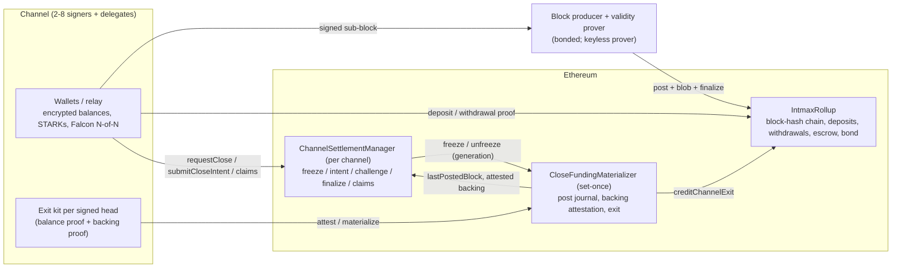
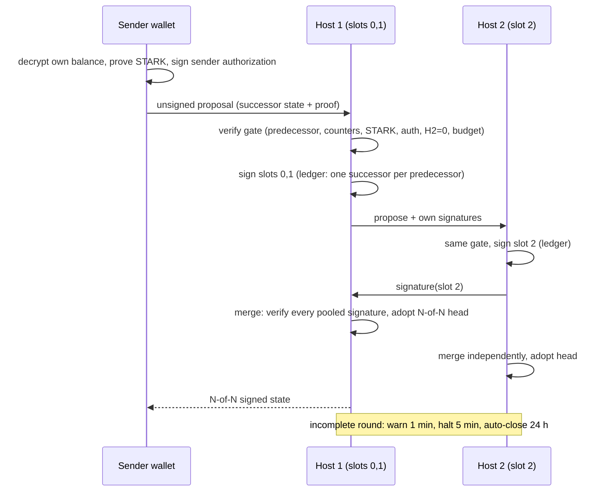
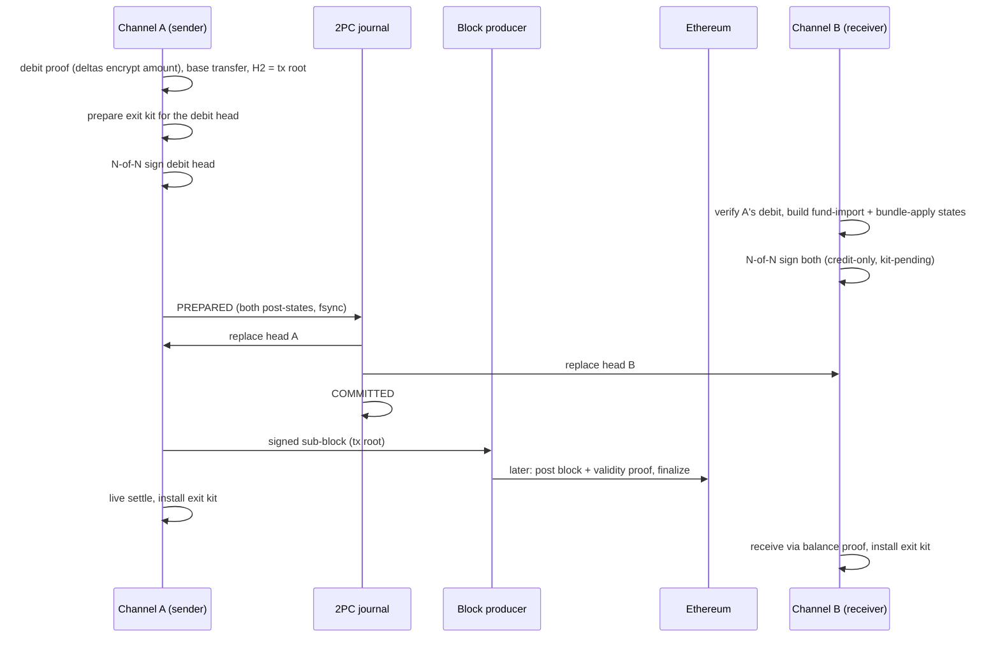
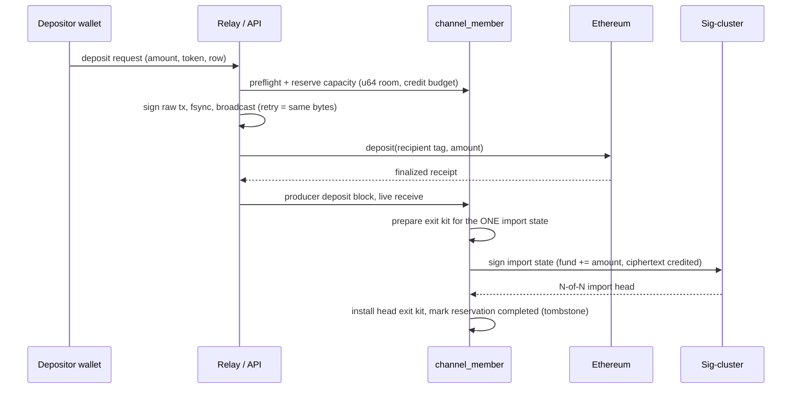

# detail3 — Intmax3 detailed design specification (current implementation)

**Describes:** branch `claude/bold-hertz-0f2708` at commit `7f129334` (2026-10-15), which contains the
three fixes `8acbe309` (close ordered against a burn by the processed-send block), `9ef32e3c` (an L1
deposit import is one signed head) and `7f129334` (close falls back to the newest backable head; a
validity candidate carrying a frozen channel's block is refused before L1).

**Supersedes:** the "current" sections of [abstract2-1.md](./abstract2-1.md) and
[detail2.md](./detail2.md). Where those documents and this one disagree, this one describes the code.
Their historical sections remain history. This document does not describe the Lean models or the
audit reports; see [lean-current-safety.md](../audit/lean-current-safety.md) for that scope.

**How to read:** Chapter 1 (Overview) uses plain words and avoids type and function names. Every
Overview line has an id (`N..` network, `C..` channels, `G..` deposit/close game). Chapter 2 (Detail)
introduces the concrete names and cites the Overview lines it realises as `→ N12` etc. Source
citations are `path:line` in the tree named above; line numbers drift with later commits.

---

## 1. Overview

### 1.1 The Intmax3 base network (the rollup)

- **N01** Intmax3 is a payment rollup on Ethereum. Ethereum holds all the money; the rollup only
  records who is entitled to what.
- **N02** The users of the rollup are not people but *channels*: every account on the rollup is a
  channel, identified by a 32-bit number.
- **N03** A channel is a small group of 2 to 8 signers (the *sig-cluster*) plus up to 1024 balance
  holders in total; the extra holders are *delegates* who have balances but do not sign.
- **N04** The rollup keeps almost no per-channel state on Ethereum. Each channel keeps its own
  balance proof and the rollup stores only a chain of block hashes and a few checkpoints.
- **N05** A *block* is a bundle of *sub-blocks*. Each sub-block belongs to one channel and carries
  that channel's single transaction commitment (a transaction tree root) for that round.
- **N06** Anyone allowed by the operator may act as *block producer*; the allow-list starts empty, so
  nothing can be posted until the operator names a producer.
- **N07** A producer prepays a *bond* on Ethereum: a base amount plus a per-block amount for every
  block of theirs that is not yet finalized. A post is accepted only while the bond covers all of them.
- **N08** Posting a block writes the new block-hash chain head on Ethereum and publishes the
  *validity proof* data as blob data (EIP-4844). The transactions themselves are not published on
  Ethereum; channels exchange them off-chain.
- **N09** A guarded post names the exact chain state it extends; if someone else posted in between,
  the post fails instead of forking the chain.
- **N10** Deposits and channel registrations made on Ethereum are folded into two separate hash
  chains with checkpoints, so a block proof built against an older checkpoint stays valid when new
  deposits arrive later.
- **N11** A *validity proof* covers the span of blocks from the last finalized state to the new head.
  It proves that every sub-block was signed by the whole sig-cluster of its channel and that all
  state roots were updated correctly.
- **N12** Anyone can attest that the posted proof bytes match the blobs, and then call *finalize*.
  Finalize checks the proof with a pinned verifier, that the proof starts at the last finalized state,
  and that it ends exactly at the posted block head.
- **N13** Finalized state roots are remembered forever. Everything that pays money out of the rollup
  later (withdrawals, channel exits) must be anchored to a finalized root.
- **N14** A posted block that is not finalized within about 12 hours of Ethereum blocks can be
  removed by anyone without a proof; the chain is rolled back to before it.
- **N15** A proof that the pinned verifier reports as *invalid* convicts the producer: the removed
  blocks' per-block bonds and the base bond are forfeited, 90% to the reporter and 10% to the
  treasury. A timeout removal forfeits nothing. A proof that merely cannot be evaluated never convicts.
- **N16** Finalizing a block releases the bond held for that producer's earlier blocks at once. With
  no unfinalized block left, the whole bond can be withdrawn.
- **N17** The *public state* of the rollup is: block number, timestamp, the channel tree, the deposit
  tree, and the tree of all previous public states.
- **N18** Each channel's leaf in the channel tree records the last block that channel posted and the
  root of that channel's own *send tree*: one leaf per block it posted, holding the previous and the
  current block number and the transaction root.
- **N19** A channel's *balance proof* is a recursive proof the channel keeps privately. It certifies
  the channel's private state (asset tree, nullifier tree, sent-transaction tree), the public state
  it was checked against, a *receive cursor* (how far the channel has processed incoming blocks), and
  a hash chain of everything it has settled.
- **N20** The *receive window* rule: a channel may advance its receive cursor up to any finalized
  block, but if it has posted a send that the cursor has not yet covered, the cursor must stop before
  that send and the preceding send must already be covered. Sends are therefore processed in order.
- **N21** Every transfer has a *nullifier* derived from the transfer, the sender and the sender's
  nonce, not from the block that settled it. Settling the same transfer twice yields the same
  nullifier and is refused once.
- **N22** Money enters the rollup by *deposit*: ETH (exact value) or a registered ERC-20 (measured
  balance increase; fee-on-transfer tokens fail). The deposit names a 32-byte rollup recipient that
  belongs to a channel.
- **N23** Money leaves the rollup by *withdrawal*: a withdrawal proof anchored to a finalized root
  lists transfers whose recipient is an Ethereum address; each is paid once (nullifier) into a
  pull-payment ledger capped by the escrow.
- **N24** A *partial withdrawal* from a channel is simply a send to a reserved *burn channel*; its
  leaf is paid by the ordinary withdrawal proof. No separate contract step is involved.
- **N25** A channel *exit* moves a channel's whole fund vector from the rollup escrow to that
  channel's settlement contract; only one set-once contract (the *materializer*) may trigger it.
- **N26** The rollup has an append-only *token registry*: index 0 is ETH, every other index is set
  once to an ERC-20 address.
- **N27** Channel registration on Ethereum is done by the deployer and records only the 2–8 signers,
  the block-proposer slot and a commitment to the signer set; delegates are never registered on L1.
- **N28** Every value-moving contract function is pinned to the deployment's chain id; the pinned
  proof-verifier adapters must report the same chain. Local devnet (chain 31337) has explicit
  exceptions (unguarded posting, short challenge windows).
- **N29** The bond amounts are immutable deployment parameters (deploy scripts default to 0.1 ETH
  base and 0.001 ETH per block).
- **N30** Finality for the off-chain services means the RPC's *finalized* tag, bound to the rollup's
  latest finalized block number and root; "latest" is never treated as durable.

### 1.2 Channels and inter-channel payments

- **C01** A channel's balances are *encrypted*: every balance holder has one lattice (Regev)
  ciphertext per token, decryptable only with that holder's own key. Nobody else, not even the other
  signers, sees individual balances.
- **C02** A channel holds up to 10 tokens. Each balance row is a 10-wide vector of ciphertexts;
  the channel's total per token (the *fund vector*) is public to its members and to L1 at close.
- **C03** The channel's *state* is a signed document: a header committing the balance rows, the
  token registry, the version counters, a hash chain of settled transactions, the fund vector, and a
  two-part tag: H1 (the balance state) and H2 (zero for an in-channel update, the channel's own
  transaction-tree root for a payment leaving the channel).
- **C04** A state is valid only when **all** sig-cluster members sign it (N-of-N). Signatures are
  post-quantum Falcon-512 over a Poseidon hash of the state. Delegates never sign.
- **C05** Each transition names its predecessor by digest and increases an epoch and a version
  counter by one, so two different successors of the same predecessor are siblings, never a chain.
- **C06** *In-channel send:* the sender proves with a small STARK, in the browser or CLI, that it
  decrypted its own balance, that the new balance is the old minus the amount, that nothing is
  negative, and that the amount ciphertext for the recipient is well formed.
- **C07** The sender also signs the transaction with a separate lightweight key (the *sender
  authorization* signature), bound to the sender's registered slot.
- **C08** The recipient is credited by adding the amount ciphertext to its own ciphertext
  homomorphically. Each credit consumes one unit of a 64-credit noise budget per cell; a cell at 64
  refuses further credits until it is re-encrypted.
- **C09** A sender spends a cell that has received credits directly (the proof decrypts it), so
  re-encryption (*refresh*) is optional maintenance, not a precondition of sending.
- **C10** Co-signers verify everything before signing: the predecessor link, the counters, the
  STARK, the sender authorization, that H2 is zero, that the fund vector, settled chain and
  nullifier state did not move, and the recipient's credit budget.
- **C11** Co-signing is one agreement round. On a single host, one process signs every slot it
  controls. In a *cluster*, each host signs only its own slots, pools the others' signatures, verifies
  every one of them, and adopts the head only when all are present.
- **C12** A signer never signs two different successors of the same predecessor with the same key:
  a durable per-key ledger returns the earlier signature on an exact retry and refuses any sibling.
  The browser worker enforces the same rule in IndexedDB before releasing a signature.
- **C13** A cluster round that is still incomplete warns after a minute, halts the channel's
  mutating operations after five minutes, and after 24 hours automatically closes the channel at
  its last fully signed state. A proposal that a host's own check refuses is dropped at once.
- **C14** Before any signature that moves assets is released, the signer must hold a prepared *exit
  kit* for exactly that successor (see G-lines): a head without an exit kit is "kit-pending" and
  blocks further in-channel signatures until the kit is installed.
- **C15** *Inter-channel payment:* the sending channel debits the sender's ciphertext and its fund
  vector, builds one base-layer transfer to the destination channel, and signs a state whose H2 is
  the root of the one-transaction tree. Authorizing the payment and agreeing to the debit are one
  inseparable signature.
- **C16** The same proof format as in-channel sends is used for the debit, extended with two
  "delta" ciphertexts (minus for the sender, plus for the receiver) that must both encrypt the public
  amount.
- **C17** The signed state and its transaction root are handed to the block producer as the
  channel's sub-block. The local journal commits first; the block reaches Ethereum later as part of a
  validity candidate.
- **C18** The destination channel imports the payment in two steps: *fund import* appends a tagged
  "unapplied incoming" leaf to its settled-transaction tree and raises its fund vector and an
  "unallocated incoming" counter; *bundle apply* swaps that leaf for the plain hash, credits the
  recipient's ciphertext and lowers the counter. Both steps are signed by the destination's
  sig-cluster.
- **C19** Both channels' new states are written to a two-phase journal before either channel's head
  is replaced; recovery rolls the journal forward and never signs a second version of the transfer.
- **C20** A channel can hold up to 10 tokens; the registry is append-only and every base-layer token
  index maps to exactly one local slot. Amounts of different tokens are never added together.
- **C21** Delegates join at any time through a cosigner-signed state that appends a balance row;
  delegates are never removed. The sig-cluster itself never changes after settlement deployment.
- **C22** A *burn* (partial withdrawal) is an inter-channel payment to the reserved burn channel with
  an Ethereum address as recipient. The rollup pays it from the ordinary withdrawal proof.
- **C23** The relay offers a burn only while the operator can afford to post the blocks that settle
  it (bond top-up plus a gas reserve), and settles it in the background without holding the channel.
- **C24** Every signed state carries a per-row *exit address* (20-byte Ethereum address) chosen when
  the row was created. No transition can change it; it is what a close pays to.
- **C25** A payment that was signed but whose block never reaches Ethereum cannot be settled, cannot
  be received, and cannot be closed on; the channel exits from its newest head whose backing is
  finalized (see G-lines).
- **C26** Nothing in a channel is proved with the heavy rollup proof systems on the client: browsers
  prove only the small lattice STARKs and sign; balance proofs, close proofs and their compact
  wrappers are produced server-side.
- **C27** The exit address, the sender-authorization key and the lattice key of a row are three
  different keys; the signer identity (Falcon) is a fourth. None is a synonym for another.
- **C28** Channel operations are refused while a settlement close is pending or finished; a channel
  that has been frozen on Ethereum cannot post new sub-blocks.
- **C29** A signed channel state is small enough to be journaled, replayed and compared byte for
  byte; every recovery path compares the exact before and after digests, never "the newest file".
- **C30** The channel's own hash chain of settled transactions and the balance proof's chain must be
  identical for a head to be exit-capable; this is what ties a signed state to the rollup's view.

### 1.3 Deposit into a channel, and the close game

- **G01** *Deposit into a channel:* the wallet reserves capacity for the exact intent and the
  candidate row first (amount fits in 64 bits, the row's credit budget has room), then signs and
  durably stores the raw Ethereum transaction, then broadcasts it; a retry resends the same bytes.
- **G02** Once the deposit is finalized on Ethereum and received by the channel's balance proof, the
  sig-cluster signs **one** new state that raises the fund vector and credits the depositor's
  ciphertext in the same step. There is no intermediate signed state.
- **G03** The deposit's rollup recipient is a channel-owned 32-byte tag, distinct from the row's
  20-byte exit address; the completed reservation stays as a tombstone so a timeout never pays twice.
- **G04** *Settlement deployment:* each channel gets one settlement contract (the *Manager*) pinned to
  the rollup, the verifiers, the signer-set commitment and a snapshot of the participants, plus a
  shared set-once *materializer* that journals the channel's posts and performs the exit.
- **G05** The materializer records the last block each bound channel posted and refuses any new post
  for a channel that is frozen or has exited; the whole batch containing such a post fails.
- **G06** *Freeze:* any signer (or any participant in the deployment snapshot, delegates included)
  may request a close. This freezes the channel on Ethereum and starts a 10-minute grace period.
- **G07** *Close intent:* after the grace period anyone may submit a signed head with its close proof.
  The head must be N-of-N signed, its fund root finalized, and its fund vector must be *attested*: a
  backing proof shows the balance proof behind it holds exactly that fund vector at a finalized root.
- **G08** *Challenge:* while the challenge window is open (one day on public chains, shorter on the
  devnet, bounded by a horizon of two periods), anyone may replace the pending head with a strictly
  newer one (higher epoch, or same epoch and higher version) that passes the same checks.
- **G09** *Cancel:* a proof that a newer version was revived by the members cancels the close,
  unfreezes the channel, and lowers the freeze counter by one; the request generation and the
  "highest cancelled version" floor are never lowered.
- **G10** *Finalize:* after the deadline has strictly passed, anyone finalizes; the finalized head's
  per-token amounts become the channel's claim caps.
- **G11** *Materialize:* anyone presents the attested backing proof again; the materializer sets a
  one-shot exit latch and moves every token of the fund vector from the rollup escrow to the Manager
  in one transaction.
- **G12** *Ordering against burns:* a backing proof carries the block up to which the channel has
  processed its own sends. The materializer accepts a head only if that block is at or after the
  channel's last posted block. So a head from before a posted burn can never close, and a burn can
  never be posted after a freeze; the burned amount is paid exactly once.
- **G13** *Claims:* each balance holder proves the decrypted amount of its own ciphertext under the
  finalized head and registers a claim; claims are paid by pull to the row's exit address, capped
  per token by the finalized amount.
- **G14** A payment that was imported but not yet applied at close is claimed through its tagged leaf
  with a separate proof; a payment first received after close is claimed through a serial
  continuation of the balance proof, which also extends the cap by the new amount.
- **G15** Funds are pulled from the rollup into the Manager by exact amount (cap minus received), and
  a payout never exceeds what was pulled.
- **G16** *Which head to close on:* the close tooling uses the latest signed head whose fund root is
  finalized; if the latest head's block never reached Ethereum, it walks back to the newest
  predecessor with a finalized backing and a retained exit kit, and never fabricates a kit.
- **G17** *Non-cooperative exit* needs no new signature from anyone: the last signed head and its
  retained exit kit are enough; only gas and an Ethereum transaction signer are needed to publish.
- **G18** The old cooperative close-funding path, the special-close penalty game and the late
  outgoing-debit correction are retired entry points that always revert.
- **G19** A validity candidate that still contains a sub-block of a frozen or exited channel is
  refused by the publisher before any Ethereum transaction, with an operator-readable error.
- **G20** Devnet exceptions (chain 31337) shorten the challenge period and allow unguarded posting;
  they are not available on public chains.

### 1.4 Diagrams

#### Architecture



#### In-channel send (cluster mode) → C06–C13



#### Inter-channel payment A → B → C15–C19



#### Deposit into a channel → G01–G03



#### Non-cooperative close and exit → G06–G17

```mermaid
sequenceDiagram
  participant P as Participant
  participant M as Manager
  participant X as Materializer
  participant R as IntmaxRollup
  participant W as Any publisher
  P->>P: pick head: latest with finalized fund root, else newest backable predecessor
  P->>M: requestClose / requestCloseAsParticipant
  M->>X: freezeFromManager(generation)
  W->>X: attestSignedHeadBacking(backing proof)
  Note over M: grace 600 s
  W->>M: submitCloseIntent(head, close proof) -- needs attested backing, finalized fund root
  Note over M: challenge window: strictly newer head may replace; cancel proof may revive
  W->>M: finalizeCloseGuarded(digest, generation) after deadline
  W->>X: materializeSignedHead(backing proof)
  X->>X: processed-send block >= lastPostedBlock, set exit latch
  X->>R: creditChannelExit(token, amount) for each token
  W->>M: pullChannelTokenFunds(token) -- exact cap - received
  P->>M: submitWithdrawalClaim / submitPostCloseClaim (or claimLateIncoming on X)
  P->>M: claimWithdrawalCredit(nullifier) -> paid to exit address
```

#### Burn (partial withdrawal) and its ordering against a close → C22–C23, G12

```mermaid
sequenceDiagram
  participant A as Channel A
  participant P as Producer
  participant R as IntmaxRollup
  participant X as Materializer
  A->>A: burn = inter-channel send to burn channel (debit head H_b)
  A->>P: sub-block with the burn
  alt burn block posted first
    P->>R: post block B
    R->>X: recordPost(A, B) -> lastPostedBlock = B
    R->>R: withdrawNative(burn leaf proof) pays once
    Note over X: a close on a pre-burn head has processed-send block < B -> refused
  else freeze first
    A->>X: freezeFromManager
    P->>R: post block containing A's sub-block
    R->>X: recordPost(A, ...) reverts -> whole post fails
    Note over A: burn never settles; the close returns the amount in its vector
  end
```

---

## 2. Detail

### 2.1 Base network: objects and functions

**`IntmaxRollup`** (`contracts/src/IntmaxRollup.sol`) is the single rollup contract → N01. Its
accounts are channels keyed by `channel_id: u32` (`src/constants.rs:16-21`) → N02.

**`SubBlock { channelId, timestamp, txTreeRoot, keyIds }`** is one channel's fast block
(`IntmaxRollup.sol:347-352`) → N05. A *block* is an array of sub-blocks; the block hash folds the
previous hash, the sub-block fields, the deposit chain and the channel-registration chain
(`:2292-2327`). Inside a batch only the last sub-block carries the new deposit and registration chain
values (`:1153-1166`). On L1 only the chain head per batch end is stored in `blockHashChainAt`
(`:1186-1188`) → N04, N08.

**Posting.** `postBlockAndSubmitGuarded` (`:983`) requires that `blockNumber` and `blockHashChain`
have not moved since the proof was built (`:983-996`) → N09; the unguarded `postBlockAndSubmit`
(`:964-981`) works only on chain 31337 → N28. Both reach `_postBlock` (`:1056`), which, for every
sub-block, calls the materializer's `recordPost(channelId, blockNumber)` and reverts the whole post if
that call reverts (`:1120-1135`) → G05, then `_submit` (KZG `postCommitment`) and `_chargeBond`.
The submission commitment covers domain, blob hashes, blob count, state root, L1 block and
submission id (`contracts/src/BlobKZGVerifier.sol:77-95, 450-468`); the blobs carry the compact
validity proof, not transactions → N08.

**Deposit and registration chains.** `deposit` and `registerChannel` fold into pending keccak
chains and record immutable checkpoints (`_recordPendingChainsCheckpoint`, `:928-959, 998-1040`);
a batch consumes the checkpoint its proof names → N10. The deposit chain is
`keccak(prev, depositor, recipient, tokenIndex, amount, auxData)` (`:1249-1256`); the recipient is
a tag-1 value `Poseidon("UID", channel_id, salt)` (`src/circuits/balance/common/recipient.rs:19-37`)
→ N22, G03.

**Bond.** `bonds[producer] = {balance, posted, released}` in one slot (`:340-345, 1694-1699`).
A post needs `balance >= baseStake + postStake × (unfinalized posts incl. this one)` (`:1065-1074`)
→ N07. `depositBond`, `withdrawBond` (`:1704-1714`), `releaseBond` (`:1726-1738`), release on
`finalize` (`:1580`) → N16. Forfeiture on proven fraud: `postStake` per removed post plus `baseStake`,
capped, 90 % reporter / 10 % treasury as pull payments; timeout removal forfeits nothing
(`:2149-2178`) → N15. `baseStake`/`postStake` are non-zero immutable constructor parameters
(`:706-708`; defaults `contracts/script/Deploy.s.sol:60-61`) → N29.

**Validity proof and finalize.** `ExtendedPublicState` = public state + block chain + deposit chain
+ deposit count + registration chain + `bp_sig_chain`
(`src/circuits/validity/block_hash_chain/ext_public_state.rs:39-46, 95`). The validity circuit's
public inputs are keccak(initial/final block number, block chain, ext commitment, prover address),
re-exposed by the MLE/WHIR wrapper as 8 u32 limbs (`IntmaxRollup.sol:2255-2290`,
`src/circuits/validity/validity_circuit.rs:36-44, 264-286`). It verifies the block-chain proof
recursively and, when `bp_sig_chain ≠ 0`, the aggregate N-of-N signature-list proof
(`validity_circuit.rs:214-262`) → N11. `attestProofData` binds proof bytes to blobs → N12.
`finalize` requires: the submission's own root, the batch end height, attested proof bytes, initial
ext commitment = `latestFinalizedStateRoot`, chain heads = `blockHashChainAt`, no height regression
(`:1517, 1539-1550, 1996-2026`); on success it sets `latestFinalizedStateRoot`,
`isFinalizedStateRoot[root] = true`, `latestFinalizedBlockNumber` and releases the bond → N12, N13.

**Fraud and timeout.** `fraudProof` convicts only on a proof-dependent INVALID verdict from the
pinned verifier; wrong preimage, gas starvation or an unevaluable proof never convict
(`:2110-2121`) → N15. A submission unfinalized after 3600 L1 blocks is removable without proof;
removal truncates that and all later submissions and rolls the chain back (`_truncateSubmissions`,
`_rollbackBatch`, `:687, 1640-1648, 2188-2252`), calling the materializer's `rollbackPost` in
descending order → N14. Fraud proofs cannot reach at or below `latestFinalizedBlockNumber`
(`:1574-1576, 1628-1631`).

**Public state and the channel tree.** `PublicState { block_number, timestamp, channel tree root,
deposit tree root, prev public-state-tree root }` (`src/common/public_state.rs:71-77`), block tree
height 63 (`constants.rs:14`) → N17. `ChannelLeaf { send-leaf index, prev, send-tree root, member
root }`; each posted block appends `SendLeaf { prev, cur, tx_tree_root }` to that channel's own send
tree (`src/common/trees/channel_tree.rs:45-49, 95-105`;
`src/circuits/validity/block_hash_chain/update_channel_tree.rs:588-604`) → N18.

**Balance proof.** `BalancePublicInputs { channel_id, public_state, block_r, private_commitment,
settled_tx_chain }` with `block_r ≤ public_state.block_number`
(`src/circuits/balance/balance_pis.rs:52-77`); `PrivateState { asset tree root, nullifier tree root,
sent-tx tree root, prev commitment, nonce, salt }` (`src/common/private_state.rs:23-41`) → N19.
Transitions: `ReceiveTransfer`, `ReceiveDeposit`, `SendTx`, `UpdatePublicState`
(`src/circuits/balance/balance_processor.rs:94-174`). `UpdatePublicState` accepts any later public
state whose previous-root Merkle proof verifies (`common/update_public_state.rs`).

**Sender ordering in a receive (C1b, 2026-10-15).** `ReceiveTransfer` additionally requires the
sender's Balance proof to be the state right before the settled send:
`send_leaf.prev ≤ sender.block_r < tx_block_number` (the bounds `SendTx` enforces on the sender's
own chain). Together with the validity rule that the nonce-checked TxV2 sits at index `channel_id`
of the block tx tree (`update_channel_tree.rs`), a channel cannot back two receipts with one
pre-send state → N20, N21. The validity circuit verifies the N-of-N signature-list proof with the
cyclic helper, so the list cannot be seeded from a foreign predecessor (C1) → N11.

**Receive window** (`src/circuits/balance/common/receive_window.rs:1-16`, callers
`receive_transfer_circuit.rs:218-245, 440-461`, `receive_deposit_circuit.rs:305-322`): with
`prev_block_r`, `new_block_r`, the channel leaf's last outgoing block `channel_leaf.prev` and the
send leaf `(send_leaf.prev, send_leaf.cur)`: `new_block_r ≥ prev_block_r`,
`public_state.block_number ≥ new_block_r`, and when a send interval is required (feature
`authenticated-tail-receive`: iff `channel_leaf.prev > prev_block_r`; default build: iff the channel
ever sent), `prev_block_r ≥ send_leaf.prev` and `new_block_r < send_leaf.cur` → N20. The feature is
off by default (`Cargo.toml:178-179`). Note that only `block_r` is bounded by the send; the public
state may be any later finalized state. This is why the exit statement exposes `block_r` (§2.5).

**Nullifiers.** Transfer nullifier = Poseidon(transfer, from, transfer_index, sender nonce)
(`src/common/transfer.rs:38-54, 124`) → N21; deposit nullifier includes `deposit_index`
(`src/common/deposit.rs:32-40`).

**Withdrawals.** `withdrawNative` / `withdrawERC20` verify a withdrawal proof anchored on any
finalized root, re-fold the leaves into the proof's public-input hash, consume each nullifier once
(`_consumeWithdrawalGuard`, `:1856-1859`) and credit pull ledgers capped by escrow
(`:1762-1817, 1856-1917`) → N23. A burn leaf (recipient tag 2 = L1 address, destination
`BURN_CHANNEL_ID = 0xFFFFFFFF`, `constants.rs:26-34`) is paid this way with no Manager flag
(`:880-897`) → N24, C22.

**Escrow and exits.** `escrowedByToken` grows on deposit (`:1245`) and shrinks on withdrawal with
checked subtraction (`:824-832`); `creditChannelExit(manager, token, amount)` is callable only by
the set-once `_channelExitMaterializer` (`:794-822`) → N25. `registerToken` is deployer-only,
set-once, index 0 = ETH (`:590, 625-634`) → N26. `registerChannel` is deployer-only, 2–8 members,
`delegateCount == 0`, ids 0 and `0xFFFFFFFF` reserved, records the IMCM member-set commitment and the
block-proposer slot (`:1292-1366`) → N27.

**Pins.** `releaseRuntime` requires `block.chainid == deploymentChainId` (`:184-186`); both MLE
adapters and their cores must report this chain and be distinct (`:719-777`) → N28. Off-chain
finality uses the RPC `finalized` tag bound to `latestFinalizedBlockNumber` / `isFinalizedStateRoot`
(README "L1 finality boundary"; `src/validity_prover_service.rs:1-7, 651`) → N30.

**Services.** `ValidityProverService::prove_candidate` proves the span from the finalized anchor to
the producer head and exports `posting_artifact` / `finalize_artifact`; the keyless prover advances
its cursor only after an L1 acknowledgement (`acknowledge_candidate_from_l1`). The operator's
`public_validity_publisher` signs exactly `postBlockAndSubmitGuarded`, `attestProofData`,
`finalize` (`src/public_validity_publisher.rs:1-7, 67-70`) → N06, N11, N12. Before the post, the
relay's publish step (`api/lib/wallet-l1.js:110-133`) refuses a candidate containing a sub-block of a
frozen or exited bound channel with `VALIDITY_CANDIDATE_CONTAINS_FROZEN_CHANNEL_BLOCK` → G19.

**Constants** (`src/constants.rs`): block number u63 (`:13`), channel id 32 bits (`:16`), token
index 32 bits (`:2`); deposit tree 63, send/nullifier/asset trees 32 (`:15-38`);
`MAX_SIG_CLUSTER = 8` with `MEMBER_TREE_HEIGHT = 3` (`:135, :62`); `MAX_CHANNEL_MEMBERS = 1024`
with wallet and balance-slot trees of height 10 (`:96, :79, :110`); `MAX_CHANNEL_TOKENS = 10`
(`:189`) → N03, C02.

### 2.2 Channel state

**`ChannelRecord`** (`src/common/channel.rs`): `member_count: u8` in `2..=MAX_SIG_CLUSTER`
(`:291-296`), `delegate_count: u16`, total ≤ 1024 (`:310-319`); slots `0..member_count` are
cosigners, `member_count..member_count+delegate_count` are delegates (`:216-232`) → N03, C21.
Its native digest **IMCR** commits `close_freeze_nonce`, `set_version`, both counts, all 1024
`pk_g` and `regev_pk_root` (`:361-387`).

**`BalanceState`** (`src/common/balance_state.rs:238-345`): `enc_balances` (1024 rows × 10 Regev
ciphertexts), `regev_pk_digests`, `recipients` (per-row 20-byte exit address, immutable under every
transition, `:296-297`) → C01, C24; `settled_tx_chain`, `settled_tx_accumulator_root`,
`state_version`, `pending_adds` (1024 × 10, `u32`), `token_registry: [u32; 10]`, `token_count` → C02,
C20. **H1** = Poseidon over the 37-element **IMB2** header (counts, registry, chain, accumulator root,
`state_version`, slot-tree root); each slot leaf (**IMS2**, 104 elements) hashes its ciphertext
digests, pk digest, `pending_adds` and recipient (`:514-573, 816-870`) → C03.

**`ChannelState` signing digest (IMCH)** commits: channel id, `epoch`, `small_block_number`,
`close_freeze_nonce`, the fund vector `channel_fund.amounts: [U256; 10]` (aligned to the registry,
never summed across tokens, `channel.rs:489-499`), `intmax_state_root`, H1, the nullifier root,
`unallocated_confirmed_incoming`, `prev_digest`, `h2_tag`, `state_version` (`channel.rs:623-647`)
→ C03, C05. `h2_tag` (**H2**) is zero for an in-channel update and the channel's own 1-leaf
`tx_tree_root` for an inter-channel send (`:592-598`); a zero root is refused on that path
(`src/circuits/channel/state_update_verifier.rs:660-670`) → C03, C15. Every transition checks
`epoch = prev.epoch + 1` and `prev_digest = prev.digest` (`state_update_verifier.rs:1485-1493`)
→ C05. The **token funds digest** (IMTF) is a fixed 92-u32-word keccak preimage over the full
registry, token count and ten U256 amounts (`channel.rs:518-522`).

**Settled-transaction accumulator** (height 20): outgoing and applied entries are raw `tx_hash`
leaves; an unapplied incoming entry is `keccak(IMUI ‖ tx_hash)` (`src/wallet_core.rs:80-90`,
`balance_state.rs:55-62`) → C18, G14. The `settled_tx_chain` is the base-settlement linkage and must
equal the balance proof's `settled_tx_chain` for the head to be exit-capable (§2.5) → C30.

**Signatures.** Cosigners sign with Falcon-512 under Poseidon hash-to-point: `sign_state` →
`sign_digest(falcon_key)` (`wallet_core.rs:1122-1128`), `verify_state_sig` (`:285-294`); the
identity `pk_g` is `Poseidon(IMFK ‖ encode(h))` → C04. `pk_b` is the BabyBear sender-authorization
key, the Regev key pair holds balances, the recipient is the exit address → C27.

**Regev** (`src/regev/params.rs`): `REGEV_N = 2048` (`:29`), `REGEV_ETA = 2` (`:33`),
`REGEV_PLAIN_BITS = 8` (plaintext modulus 256, `:38`), `REGEV_Q = 2_013_265_921` (`:43`),
`MAX_HOMO_ADDS_BEFORE_REFRESH = 64` (`:60`) → C01, C08.

### 2.3 Transitions and the proofs they carry

**In-channel send.** `build_send_token_decrypted` (`wallet_core.rs:1549, 1625-1641`) decrypts the
sender's `before` cell, refuses a short balance, and freshly encrypts `enc_amount` (to the recipient)
and `after` (to the sender). The STARK (`src/regev/transfer_stark.rs:14-19, 39-50, 181-184`;
purpose `ChannelTxDecrypted`, domain **IMDS**) proves the decryption under the sender's secret key,
the ripple-carry conservation `before = after + amount` with final carry zero, and non-negativity via
committed bit vectors → C06. The sender signs the **A11** BabyBear hash-sig over the **IMPA**
transaction digest (`wallet_core.rs:309-318, 1691`) → C07. Co-signers verify A11 against the slot's
registered `(pk_g, pk_b)` (`:1856-1897`) and run `InChannelTransferUpdateWitness::verify`: H2 = 0,
chain, accumulator, fund, unallocated and nullifier unchanged, plus the STARK
(`state_update_verifier.rs:410-470`) → C10. `solo_next_state` adds `enc_amount` homomorphically to
the recipient, zeroes the sender's `pending_adds` and raises the recipient's by one
(`wallet_core.rs:1750-1761`); `require_pending_add_increment` refuses a recipient cell at ≥ 64
(`state_update_verifier.rs:1843-1866`, used at `:544` and `:1149`) → C08. `build_refresh`
(`wallet_core.rs:2189`) re-encrypts a cell; the former refresh precondition is retired
(`:1932-1934`) → C09.

**Delegate join.** Purpose `DelegateJoin` (`src/bin/channel_member.rs:350`): a cosigner-signed state
raising `delegate_count`, `epoch`, `state_version`, refused when full (`:10867, 10906, 10938-10957`)
→ C21. **Token registration**: append-only, injective, ≤ 10, bumps `state_version`
(`balance_state.rs:761-783`); a base `token_index` resolves to one local slot or is refused
(`wallet_core.rs:5556`) → C20.

**Inter-channel debit** (`build_inter_channel_send_token_at_base_nonce_decrypted`,
`wallet_core.rs:2836-2890, 3010-3036`): the E-2 statement in decrypted form (domain **IMDU**) with
`sender_delta` / `receiver_delta` both encrypting the public amount (`transfer_stark.rs:21-25`); the
base `Transfer` carries `aux_data = tx_leaf` (normal send) or the **IMD2** burn descriptor
(`:2914-2961`); the 1-tx TxV2 tree root becomes `h2_tag` (`:2967-2971`); the head bumps `epoch`,
`small_block_number`, `state_version`, debits `amounts[token_slot]`, pushes `tx_leaf` into the chain
and the raw `tx_hash` into the accumulator → C15, C16. A11 for the debit is signed over **IMI5**,
which binds the `SmallBlockRootMessage` (domain **IMSB**, `channel.rs:828-845`, `wallet_core.rs:3100`);
the `SignedSmallBlock` starts with placeholder signatures that `attach_small_block_signatures`
replaces with the N-of-N set (`:3059, 2513`) → C17.

**Receiver import and apply** (`wallet_core.rs:4720-4768, 4790-4823`;
`state_update_verifier.rs:1762-1780`): *fund import* pushes the IMUI leaf, chains `tx_leaf`, adds the
amount to `channel_fund` and `unallocated_confirmed_incoming`, bumps `epoch` and
`small_block_number`, resets H2 to 0; *bundle apply* swaps the IMUI leaf for the raw `tx_hash` at the
same index with the same siblings, credits the ciphertext, raises `pending_adds`, lowers unallocated
→ C18. The base side proves `ReceiveTransfer` from the source's pre-send balance proof
(`src/live_balance_service.rs:1897, 2107-2134`).

**Two-phase commit.** `cosign-inter-transfer` signs A's `InterChannelDebit` and B's
`InterChannelFundImport` + `InterChannelBundleApply` in one process after checking spent and replay
ledgers (`channel_member.rs:12006, ~12092-12185`); both post-states are fsynced into the
`.inter-transfer-journal` PREPARED record before either head is replaced, recovery is an idempotent
roll-forward (`:1501-1522, 2578-2600`), and the relay runs `recover-inter-transfers` before signing
anew (`api/lib/inter-channel-send.js:161`) → C19. The sequence in `api/lib/inter-channel-send.js`
is: journal commit → `producer.postInterChannel` → live settle A → `installHeadExitKit(A)` → live
receive B → `installHeadExitKit(B)` (`:237-267`) → C17.

**Burn.** `build_burn_send` (`wallet_core.rs:3168-3192, 2938-2949`) is an inter-channel send to
`BURN_CHANNEL_ID` with a padding Regev key as phantom receiver and an `ADDRESS_TAG` recipient;
`burn_withdrawal_leaf` (`:4474`) rebuilds the withdrawal leaf; the rollup pays it on the withdrawal
proof plus the nullifier guard (`:4510-4520`, `IntmaxRollup.sol:886, 1856`) → C22. The relay runs
proving → publishing → paying in the background without holding the channel
(`hosting/wallet/pw-settlement.js:4-31`) and offers a burn only while the operator's balance covers
`baseStake + postStake × (unfinalized + posts)` plus 0.2 ETH, re-checked before signing
(`hosting/wallet/wallet-relay.js:111-159, 1523-1526`) → C23.

**L1 deposit import (one signed head).** `build_l1_deposit_import` returns one signable
`import_state` linked to the pre-deposit head (`epoch+1`, `state_version+1`,
`small_block_number+1`) with the fund vector, chain, accumulator root and the depositor ciphertext
all moved and `unallocated_confirmed_incoming` unchanged; the former fund-import state survives only
as the unsigned `fund_import_leg` verification step. `verify_l1_deposit_import_transition(prev,
record, deposit, import_state, slot, delta)` re-derives the leg from `prev`, verifies it, rebuilds
the canonical head and requires digest equality; a head chained onto the leg, the leg itself, or a
head keeping the deposit as an unallocated residue is refused. The signing purpose is
`L1DepositImport` (serde alias `l1_deposit_bundle_apply`); `L1DepositFundImport` is refused by the
signing primitive before any ledger lookup ("NOT A SIGNED HEAD"). `deposit_recovery` validates a
one-link digest chain (commit `9ef32e3c`) → G02.

**Deposit admission** (`src/bin/channel_member/deposit_capacity.rs:161-266`,
`src/channel_credit_safety.rs:255-283`, `api/lib/deposit-preflight.js:17-29, 71-109`,
`api/lib/deposit-spend.js:18-35, 52-122`): amount `u64 > 0`, slot ≤ 1023, token `u32`, candidate
slots restricted to the depositor's bound row; a closing or closed channel is refused; for every
candidate slot `pending_adds + reserved + 1 ≤ 64` and u64 headroom (`can_credit`); at most 128
pending reservations. `spendDeposit` journals the operation, reserves, signs the raw tx with
`cast mktx` through a durable outbox, broadcasts, binds the tx hash, and reuses the saved raw bytes on
failure → G01. The deposit recipient is a bytes32 tag-1 value (`deposit_capacity.rs:102-126`), the
exit recipient is `balance.recipients[slot]` (`deposit-preflight.js:58-63, 96-104`) → G03. The
pipeline (`api/lib/deposit-pipeline.js:163-239`): verified receipt → producer deposit block →
propose-only check → live receive → exit kit proved before signing → one signed head → head exit kit
installed; the reservation becomes a completed tombstone (`deposit_recovery.rs:330-345`) → G01–G03.

### 2.4 Co-signing and signature release

**Purposes.** `StateSigningPurpose` (`channel_member.rs:350-364`): `Genesis`, `DelegateJoin`,
`InChannelSend`, `InChannelBatch`, `BalanceRefresh`, `InterChannelDebit`, `InterChannelFundImport`,
`InterChannelBundleApply`, `BurnDebit`, `TokenRegister`, `L1DepositImport`, `CloseFunding`
(retired on L1, §2.6). There is no member-set-update purpose → C21.

**Ledger.** `ledgered_state_signature` keys on (channel, predecessor digest, slot); an exact retry
returns the stored bytes, a sibling successor is refused with the ANTI-EQUIVOCATION REFUSAL
(`channel_member.rs:968-978, 1388-1408`) → C12. The browser worker's
`hosting/wallet/signature-release-ledger.mjs:39-55, 131-169` holds the signature until the IndexedDB
`readwrite` transaction completes, one successor per (signer, channel, predecessor) → C12.

**Exit kit before signature.** Asset-moving purposes require a prepared exit kit for exactly that
successor (`require_prepared_exit_kit`, `channel_member.rs:684-701, 376-389`); destination credits
are the exception: they need only the predecessor head's receipt and leave the credited head
kit-pending until `install-exit-kit` (`:396-401, 632-640, 735-751`) → C14.

**Single host vs cluster.** `cosign` signs every controlled slot in one process
(`wallet-relay.js:1053-1060`). In cluster mode (`api/lib/cluster.js`, `/api/cluster/*`) the batch
window is forced to one proposal (`wallet-relay.js:1016`); `cosign-partial` runs `cosign_gate` and
signs only `INTMAX_CLUSTER_SIGN_SLOTS` (default: every controlled slot, `cluster_sign_slots`);
`cosign-merge` re-verifies each pooled signature with `verify_member_signature` and adopts the head,
exit code 3 while signatures are missing (`channel_member.rs:11383-11448`, `wallet-relay.js:296-311`)
→ C11. Only `InChannelSend` goes through the cluster round; refresh, inter-channel, burn, deposit
import and token registration sign every slot on the receiving host (`:11392-11409`). Timers:
warn 60 s (repeated), halt 300 s (mutating routes answer 503), auto-close 86 400 s at the last fully
signed head via `onAutoClose` → CLI `close` with `CLOSE_SV` (`cluster.js:13-34`,
`wallet-relay.js:284-287, 326-341, 605-616`); a proposal refused by this host's own gate aborts the
round immediately (`cluster.js:135-145`) → C13. Each slot must be held by exactly one host; the
duplicate check covers only the declared slot lists (`cluster.js:64-72`).

### 2.5 Exit kit and the backing statement

A head's **exit kit** is the backing public inputs plus the backing proof; it omits the signed-head
digest so a successor that only redistributes balances can reuse it
(`src/live_balance_service.rs:316-333`) → C14, G17. Its two proofs are the channel's recursive
**Balance proof** (§2.1) and the **CloseAssetBacking** proof
(`src/circuits/channel/close_asset_backing_circuit.rs`), which rebuilds the entire canonical asset
tree from the empty root and the one ten-token vector, so a scalar commitment or a single-token
opening is insufficient → G07.

**`CLOSE_ASSET_BACKING_PUBLIC_INPUTS_LEN = 35`** (`:67`):

| limbs | field | meaning |
|---|---|---|
| 0 | `channel_id` | the channel |
| 1..9 | `settled_tx_chain` | the Balance proof's settled chain → C30 |
| 9..17 | `token_funds_digest` | IMTF over the full registry and vector → C02 |
| 17..25 | `finalized_extended_state_commitment` | the backing root; must be finalized → N13 |
| 25 | `anchor_block_number` | `public_state.block_number` of the Balance proof (u63) |
| 26 | `processed_send_block_number` | the Balance proof's `block_r`; ≤ anchor (`:146-152`) → G12 |
| 27..35 | `balance_state_commitment` | Poseidon of the full Balance public inputs (seeds late receipts, §2.6) |

The composition key is `(channel_id, settled_tx_chain, token_funds_digest)` and the head's own
`settled_tx_chain` and IMTF must equal it (`validate_signed_head_backing_composition`,
`src/public_close_prover.rs`) → C30. Because sends are processed in order (`SendTx` requires
`tx_block_number ≥ prev.block_r ≥ send_leaf.prev`, `send_tx_circuit.rs:125-145`), `block_r ≥ B`
holds only if the send at block B was processed; that is why the statement exposes `block_r` and
not only the anchor (commit `8acbe309`) → G12.

**Attestation.** `attestSignedHeadBacking(manager, proof)` (`CloseFundingMaterializer.sol`)
decodes 35 limbs (`:577`), requires `pi[25] < 2^63` and `pi[26] ≤ pi[25]` (`:581`), and stores the
greatest processed-send block seen per statement key (`signedHeadBackingProcessedSendPlusOne`);
re-attesting the same statement with a later value raises it → G07.

**Head selection** (commit `7f129334`): `channel_member close` uses the latest head when
`isFinalizedStateRoot(channel_fund.intmax_state_root)` holds, otherwise walks `prev_digest` through
the content-addressed signer exit-kit archive to the newest predecessor whose backing root is
finalized and whose kit is retained, re-verifies it and announces the fallback on stderr;
`CLOSE_HEAD_FALLBACK=off` opts out; no kit is ever fabricated. The delegate does the same before
`requestCloseAsParticipant` and pins the chosen head (`node/delegate/branches/exit.js`) → G16, C25.

### 2.6 Settlement contracts: Manager and Materializer

**Deployment.** `ChannelSettlementManager` constructor: channel id, block-proposer slot and key,
delegate count, participant root, challenge period, verifier, registry (the rollup), materializer and
2..8 member bindings (`ChannelSettlementManager.sol:845-870`, line numbers at `5382bebd`). On chains
other than 31337 a challenge period under 86 400 s reverts (`:881-883`; repeated by `releaseRuntime`,
`:829-833`) → G20. The IMCM member-set commitment must equal the rollup's
`channelMemberSetCommitment` (`:944-963`) → N27. The participant root is a depth-10 tree of
`keccak(IMPR ‖ slot ‖ pkG ‖ recipient)` (`:934-944, 966-968`); `activeDelegateCount` is a floor:
the verifier rejects close-PI limb 94 below it and sets no ceiling (`:661-672`,
`ChannelSettlementVerifier.sol:229-238`) → C21. `IntmaxRollup.registerSettlementManager` installs the
materializer once and calls `bindManager`, which requires a finalized rollup head and seeds
`lastPostedBlock` with it (`IntmaxRollup.sol:782-810`, `CloseFundingMaterializer.sol:273-295`) → G04.
`recordPost` refuses a frozen or exited channel and journals the per-channel predecessor;
`rollbackPost` restores it in descending order (`:331-349`) → G05.

**Statuses** `Active → ClosePending → Closed`; materializer `frozenGeneration` (0 or g) and the
`materializedChannelExit` latch.

**Freeze.** `requestClose` requires `isMemberRecipient[msg.sender]` (`:1046-1056`);
`requestCloseAsParticipant(slot, pkG, siblings, nonce, hcv)` proves `(slot, pkG, msg.sender)` against
the participant root (`:1065-1078`); both must name the current `currentCloseFreezeNonce` and
`highestCancelledRevivedStateVersion` exactly (`:1049-1053`). `_requestClose` bumps
`closeRequestGeneration` and the freeze nonce, sets ClosePending and calls `freezeFromManager`
atomically (`:1080-1094`; `CloseFundingMaterializer.sol:298-310`) → G06.

**Intent.** `submitCloseIntent(intent, compactProof)`: ClosePending, `now ≥ requestedAt +
GRACE_BEFORE_PROCESS_SECS (600)` (`:565, 1164-1182`), current freeze nonce, horizon fixed at
`now + 2 × challengePeriod`. `CHALLENGE_PERIOD_SECS = 86 400` (floor; `:197, 580`),
`MIN_CLOSE_RESPONSE_SECS = 3 600` (`:617`). Deadline = min(now + challengePeriod, horizon), floored
at now + minResponse and capped at horizon + minResponse (`:1236-1251`). The close proof (103 limbs,
`ChannelSettlementVerifier.sol:40`) is bound to the member-set commitment, `member_count` (limb 93,
exact) and the delegate floor (limb 94) (`:1866-1901`); limbs 95..102 (IMTF) must have an attested
backing (`requireSignedHeadBacking`, `:1836-1841`) whose processed-send block is ≥ `lastPostedBlock`
(`CloseFundingMaterializer.sol` after `8acbe309`) → G07, G12. Metadata must be canonical:
`closeNonce == closeFreezeNonce`, `snapshotMediumBlockNumber == 0`, `burnTxHash == 0`
(`:1847-1853`); the fund state root must be finalized (`:1806-1808`). Close id =
`keccak(IMCS ‖ channelId ‖ finalChannelStateDigest ‖ closeFreezeNonce)` (`:1798-1802`).

**Challenge.** A replacement must land by the deadline and by horizon + minResponse, carry the
current freeze nonce and be strictly newer in `(epoch, stateVersion)` (`:1113-1163, 1912-1915`)
→ G08. **Cancel** needs a cancel proof (29 limbs) for a revived version above the pending one and
above `highestCancelledRevivedStateVersion` (`:1291-1369`); it restores Active, clears the pending
close, decrements the freeze nonce by one and unfreezes the materializer (`:1373-1451`); it never
lowers `closeRequestGeneration` or the revived-version floor (`:1373-1378`) → G09.

**Finalize.** `finalizeCloseGuarded(expectedDigest, expectedGeneration)` is permissionless; deadline
strictly passed (`:1473-1494`); it stores digests, H1, settled chain, accumulator root, adds each
slot amount to `finalizedChannelFundAmount[baseToken]`, stores IMTF and sets Closed (`:1495-1536`)
→ G10.

**Materialize.** `materializeSignedHead(manager, backingProof)` is permissionless: attested proof,
settled chain and IMTF equal to the finalized ones, frozen and matching generation, Closed, not
exited, finalized backing root, anchor ≤ finalized head, processed-send block ≥ `lastPostedBlock`
(`CloseFundingMaterializer.sol:421-438, 500-517` plus `8acbe309`); it sets the latch first, then
calls `rollup.creditChannelExit` per nonzero token (`:533-537`) and saves `lateBalanceStateCommitment`
from limbs 27..35 → G11, G12.

**Claims.** `submitWithdrawalClaim` (50-limb E-3 proof, `ChannelSettlementVerifier.sol:57`):
Closed, finalized digest, active token slot, unused nullifier, verified against
`finalizedBalanceStateH1` (`:1557-1603`); the recipient is the claimant's leaf recipient in the signed
H1, for delegates alike (`:1830-1845`) → G13, C24. `_accrueWithdrawal` enforces
`totalWithdrawn ≤ finalizedChannelFundAmount + lateIncomingFundAmount` per token and one payout per
nullifier (`:1652-1660`) → G13, G14. `pullChannelTokenFunds(token)`: Closed and materialized, pulls
exactly `cap − received`, reverts on any balance-delta mismatch, token 0 native (`:1689-1727`) → G15.
`claimWithdrawalCredit(bytes32)` pays one record to `msg.sender == payout.recipient`, capped by
`receivedChannelFunds`, deleting the record before the transfer (`:1733-1771`) → G13.
`submitPostCloseClaim` (58 limbs, version 2): IMCK nullifier from (closeId, incomingTx, receiverPkG),
proof against H1 and the accumulator root, same cap (`:503, 1618-1641`) → G14.
`claimLateIncoming(manager, proof)` on the materializer (59 limbs, limb 58 = 1): closeId, H1, cursor
commitment at limbs 17..25, finalized root at 33..41, anchor window, unused per-channel nullifier,
registered token, nonzero recipient and amount; it advances the cursor to limbs 25..33, credits
rollup escrow and calls `creditLateIncoming` with an **IMLC** claim key
(`keccak(0x494d4c43 ‖ channelId ‖ closeId ‖ nullifier)`), which raises `lateIncomingFundAmount`
(`CloseFundingMaterializer.sol:443-485`, Manager `:1645-1650`) → G14.

**Retired entry points** (always revert): `submitSpecialClose` (`:1287-1289`),
`submitLateOutgoingDebitCorrection` (`:1465-1467`), `authorizeCloseFunding` (`:1666-1668`),
`materializeNative` / `materializeERC20` (`CloseFundingMaterializer.sol:617-635`);
`applyMemberSetUpdate` no longer exists (`:1020-1022`) and the producer refuses member-set updates
(`src/bin/block_producer_service.rs:43, 944-954`) → G18, C21.

**Keyless publication.** `public_close_prover` builds close proofs from the public backing artifact
and uses no wallet keys (`src/bin/public_close_prover.rs:1, 24-30`); `public_close_publisher`
journals attest → submit → finalize → materialize and fsyncs each raw transaction before broadcast
(`src/public_close_publisher.rs:1-8, 208-267`); its readiness check is read-only and point-in-time
(`:8152-8161`). The delegate refuses a new participant freeze unless readiness for the exact head,
manager and freeze nonce passes (`node/delegate/participant-close.js:413-425`) → G17.

### 2.7 Invariants the design relies on (where each is enforced)

| invariant | enforced by | overview |
|---|---|---|
| one successor per predecessor per signer key | native ledger, browser fence (§2.4) | C12 |
| no in-channel signature on a kit-pending head | `require_prepared_exit_kit` (§2.4) | C14 |
| a head closes only with its exact fund vector | IMTF in IMCH + 35-limb backing (§2.5) | G07 |
| a pre-burn head cannot close after the burn posts | processed-send block ≥ `lastPostedBlock` (§2.5, §2.6) | G12 |
| a burn cannot post after a freeze | `recordPost` reverts the whole post (§2.1, §2.6) | G05, G12 |
| each nullifier pays once | rollup `_consumeWithdrawalGuard`, Manager `_accrueWithdrawal` | N21, G13 |
| per-token caps | `finalizedChannelFundAmount (+ lateIncomingFundAmount)` | G10, G14 |
| only the materializer moves escrow to a Manager | `creditChannelExit` caller check | N25 |
| no intermediate signed deposit head | single `L1DepositImport` head (§2.3) | G02 |
| the newest backable head is the one closed | `close` head fallback (§2.5) | G16 |

### 2.8 Open items carried from the fixes (owner decisions)

- The CloseAssetBacking VK rotates with the 35-limb statement; the checked-in
  `close_asset_backing_*` fixtures and the pinned adapter must be regenerated per
  [the regeneration runbook](../tasks/regen-and-redeploy-runbook.md) before any deployment
  (`DeployCloseCli` refuses `backingPublicInputCount != 35`).
- Whether to add a second on-chain layer refusing a close whose unallocated residue is not covered
  by IMUI leaves (the Manager cannot distinguish the heads by statement key; the structural fix
  removed the head instead).
- The frozen-channel sub-block refusal in the publisher is an operator-readable stop, not an
  automatic rebuild of the candidate; the journal format makes rebuilding unsafe today.
- The late-incoming adapter is checked at deployment only for pinning, not for its configuration
  digests; cross-lane (residual + late) real-proof tests do not exist yet.

### Appendix A — Code comments known to be stale at `7f129334`

These were found while reconciling this document with the code; the code behaves as this document
says, the comments do not.

- `IntmaxRollup.sol:546-549` says `MAX_CHANNEL_MEMBERS = 8` "mirrors" Rust; the Rust value is 1024,
  8 is `MAX_SIG_CLUSTER`.
- `IntmaxRollup.sol:310-311` says the submission commitment covers the proof hash and length;
  `BlobKZGVerifier` does not include them.
- `IntmaxRollup.sol:56-59` lists non-binding public inputs as fraud; since the C-1 fix they never
  convict (`:2069-2121`).
- `IntmaxRollup.sol:1752-1753` says the withdrawal root must equal `latestFinalizedStateRoot`; any
  finalized root is accepted (`:1893-1894`).
- `IntmaxRollup.sol:2000-2004` mentions `reclaimStake`, replaced by `releaseBond`.
- `IntmaxRollup.sol:899-901` says sub-block data lives in calldata for DA; only headers do.
- `IntmaxRollup.sol:1358-1359, 1452-1453` say registration covers members + delegates; delegates are
  always 0 at registration.
- `ChannelSettlementManager.sol:1821-1824` says the delegate count is bound by strict equality and
  joins are frozen; it is a floor and joins continue.
- `ChannelSettlementManager.sol:574, 590` refer to `finalizeClose()`; the entry point is
  `finalizeCloseGuarded`. `:169, 782` mention IPW2 and terminal-child funding, both retired.
- `CloseFundingMaterializer.sol:8` titles a retired abstract contract in the same file as the live
  materializer.
- `src/common/channel.rs:213`, `balance_state.rs:240` give `member_count` as `2..=MAX_CHANNEL_MEMBERS`;
  the code enforces 2..8. Several docstrings still say "SPHINCS+"; signing is Falcon-512.
- `balance_state.rs:308-311, 921` describe fund import as chaining `tx_hash` uniformly; the code
  chains `tx_leaf` and inserts an IMUI leaf. `channel.rs:938-940` says normal sends keep `aux_data`
  zero; it is `tx_leaf`.
- `wallet_core.rs:2964, 3383, 3411` cite a `pw-submit` pre-flight removed by `909658b1`;
  `:3404-3405` cite stale line numbers.
- `small_block_message.rs:6-7` shows the IMSB preimage without `bp_pk_g`; `channel.rs:420` hashes it.
- `channel_member.rs:367-372, 438-439` describe the pre-receipt fail-closed rule and a "two-state
  import chain", both superseded.
- `wallet-relay.js:116-117` says an unsettleable burn holds its channel; nothing holds it since
  `5382bebd`.
- `src/common/block.rs:36-38` calls the channel id "5-byte"; it is u32.
